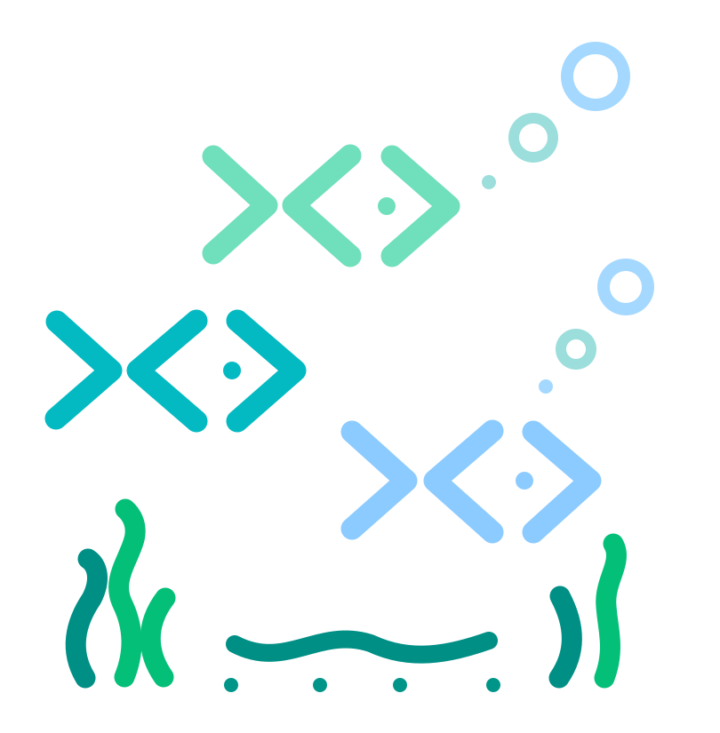

<div align="center">

<br />



<br />
<br />

<h1>sink</h1>

<h3>A little underwater world in your terminal 🫧</h3>

<p>A lightweight, interactive terminal aquarium written in Rust.</p>

<p>
  <a href="https://www.rust-lang.org/"></a>
</p>

<br />

<p>If you like this project, please consider giving it a ⭐ on GitHub!</p>

<br />

</div>

---

## Table of Contents

- [📖 About](#about)
- [🎨 Visual Direction](#visual-direction)
- [🐟 Planned Features](#planned-features)
- [🧩 Roadmap](#roadmap)
- [🛠️ Technologies](#technologies)
- [📚 Getting Started](#getting-started)
- [🤝 Contributing](#contributing)
- [📜 License](#license)

---

<a id="about"></a>

## 📖 About

The idea is super simple: run `sink` and turn your terminal into a small procedural underwater world.

`sink` should feel like a tiny living environment. Fish swim around, bubbles rise, plants sway, and little interactions make the aquarium feel alive. The scene should vary between runs so it doesn't look exactly the same every time.

The goal is lots of small details. It should stay small, charming, and easy to run, with low CPU and memory usage. Opening a terminal and typing `sink` should feel fun.

---

<a id="visual-direction"></a>

## 🎨 Visual Direction

I want `sink` to be:

- lightweight
- colorful
- smooth
- minimal
- procedural
- terminal-native
- especially nice on transparent terminals

Keep the terminal's existing background untouched so the aquarium looks good in transparent terminals.

Plants and stones should use soft, curved character shapes. Darker plants and rocks sit in the background, with brighter foreground objects drawn over them to give the scene depth.

The image below is the visual concept for the aquarium:


---

<a id="planned-features"></a>

## 🐟 Planned Features

- **Three fish sizes:** Tiny fish swim in little schools. Medium fish can swim alone or in small groups. Larger fish are less likely to group together.
- **Natural movement:** Fish have different movement patterns, and schools move together without looking rigid.
- **Procedural scenery:** Plants, rocks, and seaweed vary between aquariums, with softer shapes and darker background layers.
- **Bubble variation:** Use `.`, `o`, and `O` for tiny, small, and large bubbles.
- **Mouse interaction:** Clicking the water creates bubbles and startles nearby fish.
- **Terminal support:** The aquarium adapts to resizing, uses terminal colors, and restores the terminal when it exits.

---

<a id="roadmap"></a>

## 🧩 Roadmap

### First version

- [ ] Scaffold the Rust app and terminal renderer.
- [ ] Generate plants, rocks, and foreground/background layers.
- [ ] Animate the three fish sizes and tiny schools.
- [ ] Add rising bubbles in `.`, `o`, and `O` sizes.
- [ ] Add click interactions and startled fish.
- [ ] Handle terminal resizing and clean exit.
- [ ] Measure CPU and memory usage and keep animation smooth.

### Future experiments

- Different fish species and personalities
- Coral and different environments
- Custom palettes and day/night variations
- Seeded worlds
- Rare creatures and little easter eggs
- Currents and predators
- Idle / screensaver mode
- Configuration options
- Easy installation with a single command

These are ideas to explore as the project grows. `sink` shouldn't become a full aquarium simulator.

---

<a id="technologies"></a>

## 🛠️ Technologies

- **Language:** Rust
- **Rendering:** Terminal characters and colors

The Rust project and its dependencies haven't been added yet. Keep dependencies minimal, startup fast, and CPU and memory usage low.

---

<a id="getting-started"></a>

## 📚 Getting Started

Clone the repository to explore the concept and follow development:

```bash
git clone https://github.com/ItaiHammer/sink.git
cd sink
```

There is no runnable app or installation command yet. Build and run instructions will be added once the Rust project is scaffolded.

---

<a id="contributing"></a>

## 🤝 Contributing

Ideas and contributions are welcome. [Open an issue](https://github.com/ItaiHammer/sink/issues) with a visual idea, terminal compatibility note, or feature suggestion, or submit a pull request with a focused change.

Keep changes aligned with the goal: a small, lightweight aquarium with lots of charming details.

---

<a id="license"></a>

## 📜 License

`sink` is licensed under the [GNU General Public License v3.0](LICENSE) (`GPL-3.0-only`).

You can use, modify, and share it, including commercially, under the GPL's terms. Distributed modified versions must remain under GPL, and distributions must provide the corresponding source as required by the license.

[Back to top](#table-of-contents)
